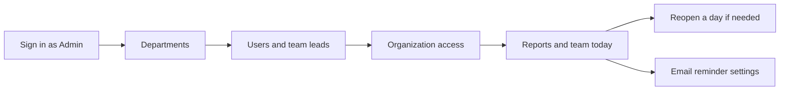
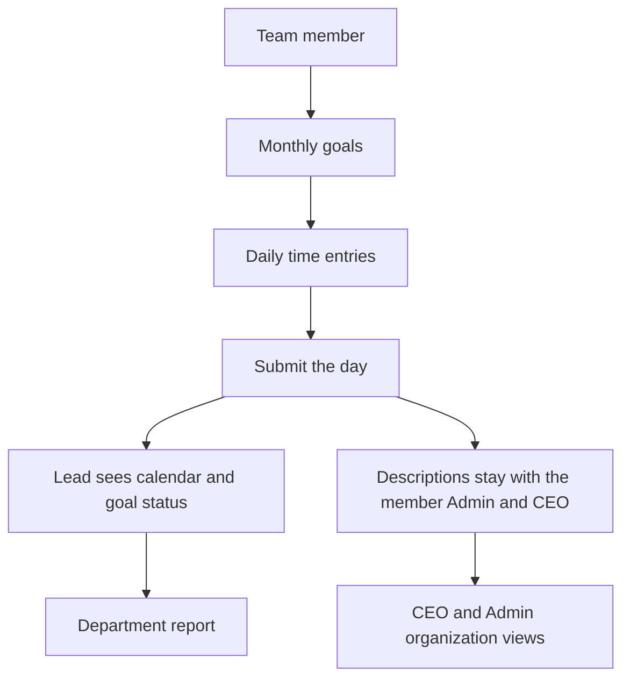
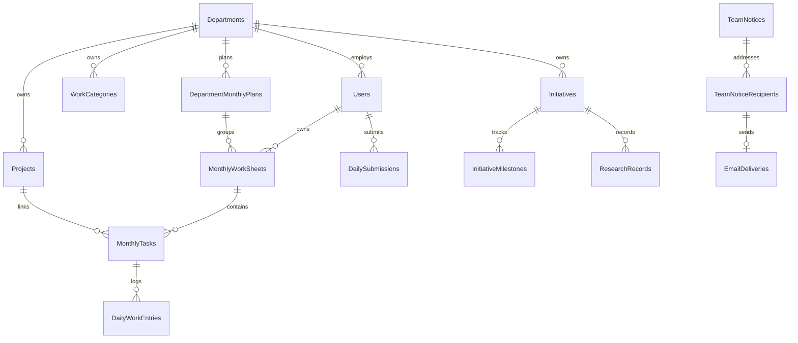

# WorkTracker — Complete Application Feature and Technical Assessment

Inspection date: 3 November 2026.  
Scope: repository source, EF Core model, a read-only PostgreSQL query, and the existing unit-test suite.  
No application code, configuration, permissions, migrations, or database rows were changed. No emails were sent.

This report describes the application that is in the repository and the database named `worktracker`. It does not treat earlier feature requests as implemented unless the code and data show that they are.

## 1. Executive summary

WorkTracker is an internal engineering ledger. A person plans goals for a month, records timed work against those goals, and submits a day. Team leads manage their own department. Admin manages departments, organization access, and reminder settings. CEO is a read-oriented organization role.

The working core is authentication, departments, team membership, projects, monthly goals, daily time entries, submission, reports, and Excel/PDF export. Those areas have real rows in the database. Research categories and R&D initiatives are built in the API and the screens, but the live database has zero categories and zero initiatives.

Two email paths exist and they are not the same:

- A weekday 5:00 PM reminder sends a plain-text task note through SMTP to a fixed address list. The sender mailbox is `sanju.k@intechadditive.com`. This audit did not send or confirm delivery.
- A newer monthly-plan reminder can address every active department member from the same mailbox through Microsoft Graph. The code, tables, and Admin screen exist. The job is switched off, Graph credentials are empty, and there are zero reminder runs. It is not operational.

Automated tests cover business rules only. They do not call the API, the browser, or Microsoft Graph. This audit ran those tests: 31 passed, 0 failed.

## 2. Complete feature inventory

Roles in code are `Admin`, `CEO`, `TeamLead`, and `TeamMember`. There is no separate Employee role. TeamMember is the employee.

### A. Authentication and user management

| Feature | What it does | How it works | Who can use it |
|---|---|---|---|
| Login | Issues a JWT after email and password | `POST /api/auth/login`. Password checked with BCrypt. Token lifetime comes from `Jwt:ExpiryHours` (12 in development). | Anyone with an active account |
| Current session | Restores the signed-in user | `GET /api/auth/me`. The React app stores the token and sends `Authorization: Bearer`. | Signed-in user |
| Logout | Ends the browser session | Client removes the token. The server does not keep a revocation list. | Signed-in user |
| Change password | Replaces the password when the current one is supplied | `POST /api/auth/change-password`. New password minimum length 8. | Signed-in user, on Settings |
| Create user | Admin or team lead creates an account | `POST /api/users`. A team lead can create a member only in their own department. | Admin, TeamLead |
| Activate or deactivate | Turns an account on or off | Organization-access status endpoint for admin. Inactive users fail login. | Admin |
| Invite a team member | Emails a join link | `POST /api/my-team/invitations`. Accept at `POST /api/team-invitations/accept` and `/join`. Token is stored as a hash. | TeamLead for their department; Admin can also manage users |
| Invite a CEO | Sends an activation invite | `POST /api/organization-access/ceo`, accept at `POST /api/ceo-invitations/accept` and `/activate`. | Admin |
| Assign CEO or return to a department | Changes organization role | `POST /api/users/{id}/organization-role`. CEO accounts have no department. Admin cannot change their own role. | Admin |
| Profile | Shows name, email, role, title | Settings page reads the JWT user. Name and email are not edited there. | All roles |
| Password reset | — | No forgot-password endpoint, email, or screen. | Not present |
| External identity provider | — | No Entra sign-in for users. Entra is only designed for the mailbox sender. | Not present |

### B. Department management

Departments are created and renamed by Admin (`/departments`, `POST` and `PUT /api/departments`). A department can be deactivated only when it has no active users and no active projects (`DepartmentRules.CanDeactivateDepartment`).

Membership is one department per user (`User.DepartmentId`). There is no multi-department membership and no separate transfer workflow. Moving someone is an update of that foreign key. A monthly sheet keeps the department it was opened in, so old goals stay with the old department.

A department has at most one team lead (`HasSingleOrNoLead`). Only Admin can appoint a different lead (`CanChangeTeamLead`). A team lead cannot move a person in from another department.

Live departments on 3 November 2026: Machine Software (6 active people), Optics (2), Application (0), design (0). All four are active.

### C. Team management

Team lead screen: `/my-team`. Member screen with the same route is read-oriented for TeamMember. Admin uses `/team`.

Implemented actions:

- List the department.
- Add an existing active person who is unassigned, or who is already in that department.
- Taking a person from another department requires Admin.
- Invite a new person by email.
- Revoke a pending invite.
- Remove a member. A lead cannot remove themselves or the other lead through the member-remove rule.
- Send a team notice to selected people or the whole department.

Team workload is visible as plan status, goal counts, and calendar submission marks. Daily descriptions are not included for a team lead. See daily privacy below.

### D. Dynamic work categories

Categories are department-owned rows in `WorkCategories`, not a hardcoded list. A lead or admin can create, rename, reorder, deactivate, and reassign work from one category to another inside the department. Category names are normalized to a `NameKey`. A category from another department cannot be assigned.

Projects, monthly goals, and initiatives can point at a category.

The live table has **0 rows**. The screens and API are present. Nobody has saved a category in this database, so category behavior has not been exercised on real data.

### E. Project management

`Projects` belong to one department and optionally one owner, one work category, a priority, a status (`Active`, `OnHold`, `Completed`, `Cancelled`), and start and end dates. Admin and team leads create and edit them (`/projects`). Members can read department projects. A project that already has monthly goals cannot change department. Only Active or OnHold projects can be linked to a new goal.

There is no project-member table, no project milestone table, and no project history table. History of related goal edits is in `AuditLogs`. The live database has 23 projects.

Progress is not stored on the project. Executive views derive risk from the end date, blocked goals, and overdue goals (`ExecutiveMetrics.ProjectAtRisk`).

### F. Monthly planning

Two layers:

1. Personal sheet: `MonthlyWorkSheets`, one per user per year and month, status `Open` or `Locked`.
2. Department plan: `DepartmentMonthlyPlans`, with summary, risks, comments, and status `Open`, `InReview`, or `Closed`. Personal sheets can point at that plan.

Goals are `MonthlyTasks`: title, description, project, category, optional initiative, priority, planned start and end, estimated hours, progress percent, status, remarks. Statuses are Planned, InProgress, Completed, Blocked, and Cancelled.

Rules that are in code and covered by unit tests:

- Cancelled goals are excluded from plan completion.
- A Completed goal counts as 100 percent even if the stored progress is lower.
- If estimated hours sum to more than zero, completion is the hours-weighted average. Otherwise it is a simple average. Result is rounded to one decimal.
- Logging time does not change that percentage.
- Duplicate active titles on the same project are rejected. Cancelled titles do not count as duplicates.
- Setting Completed fills progress to 100 and sets actual end to today when empty. Leaving Completed clears actual end.
- A locked sheet cannot be edited until a lead or admin unlocks it.
- CEO can read plans and cannot edit them.
- A team lead can edit plans for people in the same department. A member can edit only their own.

Live data: 18 sheets and 20 tasks. November 2026 sheets exist for several people. Some sheets have zero tasks. Two Machine Software members have no November sheet.

### G. Daily work tracking

`/daily` records `DailyWorkEntries`: start, end, duration, description, status, remarks, and a required monthly goal. Overlapping times on the same day are rejected. Duration is calculated from the clock times.

A day is submitted through `DailySubmissions`. Status `Submitted` is the green calendar mark. Logged hours with status `Pending` are not submitted. Holiday and Leave can be marked. A submitted day cannot be edited until it is reopened.

Reopen is Admin only, in both the API and the button on the daily page. The README still says a team lead can reopen a day. That sentence is out of date.

Calendar: `GET /api/daily-work/calendar` returns each day with minutes and a submitted flag. A team lead can load a department member's calendar. Admin and CEO can load anyone's. The employee profile shows that calendar.

Privacy: `DepartmentRules.CanViewDaily` allows the person, Admin, or CEO. A team lead receives 403 for another person's day, month timeline, and description list. The employee overview therefore returns recent entries only for self, Admin, or CEO, and it sets `ActualHours` to 0 for a team lead even though the calendar still shows hour totals. Department reports sum minutes and do not return the private description text.

Live data: 65 daily entries.

### H. R&D initiative management

This is a separate module, not only a project flag. An initiative has a department, optional category and project, owner, collaborators, status, priority, dates, objective, hypothesis, stage, success criteria, experiment plan, conclusion, milestones, and research records.

Stages are a single field: Idea, Research, ProofOfConcept, Validation, Pilot, Completed. They are not separate workflow records. Experiments, findings, and evidence are text on the initiative or on `ResearchRecords` (`Method`, `Findings`, `Outcome`, `EvidenceLinks`, `NextSteps`). There is no file upload.

A monthly goal can optionally point at an initiative. Daily entries reach an initiative only through that goal. They are not a research log by themselves.

Who can edit: Admin, or a team lead in that department. Members can add research records when they own or collaborate on the initiative. The portfolio screen is Admin and CEO.

Live data: **0 initiatives**. The module is implemented and unused.

### I. Team notifications

Team leads compose a notice on Manage My Team. Admin reviews organization notice history at `/team-notices`.

Channels: Email, InApp, or Both. Categories: General, Project, Plan, Deadline, Meeting, Blocker. Recipients are chosen from the department on the server. The client does not get to invent outside addresses. People are not placed on one shared CC list. Each recipient gets their own delivery row.

In-app rows live on `TeamNoticeRecipients` with `ReadAt`. Unread count and mark-read are `GET /api/notifications`, `POST /api/notifications/{id}/read`, and `POST /api/notifications/read-all`. Those rows are independent of email status.

Email rows are `EmailDeliveries`. A background dispatcher runs about every 30 seconds. Success is stored as `SentToProvider`, which means the provider accepted the message, not that the mailbox received it. Failed sends can be queued again by an admin or lead retry action, up to 3 attempts. Permanent SMTP failures are not retried forever. A duplicate notice inside a short window is blocked.

The sender is the configured mailbox, display name WorkTracker, or "Name via WorkTracker" when a reply-to name is set. If Graph is not configured, this path uses SMTP.

Live data: 1 team notice. This audit did not open it or resend it.

### J. Automated email reminders

**Weekday task reminder.** `DailyReminderService` polls every minute. Time zone is Windows `India Standard Time`. It skips Saturday and Sunday, and it sends at `Email:Hour` and `Email:Minute`, which are 17:00. Recipients are the six addresses in `Email:Recipients`, not the department tables. Idempotency is an audit row for that date. Missed days are not replayed as a backlog beyond the same-day check in that service. Body is plain text open tasks plus a short KPI note. This audit did not watch a 5:00 PM run.

**Monthly-plan reminder.** `PlanReminderService` uses the same clock and default time, but its own settings row. Defaults observed in the database: enabled false, missing-plan true, department summary false, 17:00, weekdays Monday–Friday. Recipients are computed each run: active department, active user, role TeamLead or TeamMember, valid email, one row per user. Admin and CEO are excluded. A lead also receives their own personal mail. A second department-summary mail is sent only when that option is on, and only to that department's lead.

No sheet for the month produces a missing-plan mail when that option is on. An empty sheet still produces a personal mail with no goals. Cancelled goals stay visible and stay out of the counted totals. Daily descriptions are not in either template.

Graph `202 Accepted` is stored as Accepted, never as Delivered. Transient failures retry up to 3 times. The idempotency key is the date, message type, user, and reporting month. There is no bounce feed from Exchange, so Bounced is not produced for these rows.

Admin screen: `/settings/reminders`. It can preview, save the schedule, and send a test only to the signed-in admin loaded from the database. Outlook shows Pending while tenant, client, and certificate are empty.

Live data: settings exist, **0 runs**, **0 deliveries**.

### K. CEO and organization management

`/executive` opens for Admin and for a CEO who has overview access. Admin always has overview and reports. A CEO receives those rights from `UserPermissions`, which Admin grants on `/organization-access`.

Screens: executive overview, departments, projects, monthly plans, risks and delays, research portfolio, and organization reports. Risks are rule-based: overdue open goals, blocked goals, projects past their end date, and goals not updated for 14 days. This is not a predictive model.

CEO cannot edit plans, daily logs, or departments. Admin can still use the management screens.

Live data: 1 active Admin, 0 CEO users, 0 CEO invitations.

### L. Reports and exports

Personal report: `/reports/me`, `GET /api/reports/monthly`. Department report: `/reports/team`. Organization report uses the same team endpoint with an organization flag, limited to people allowed to see organization reports.

Exports, both formats unless noted:

- Monthly workbook and PDF.
- Team workbook and PDF.
- Date-range workbook and PDF. Another person's range requires daily-view rights, so a team lead cannot export someone else's descriptions.
- One-day workbook and PDF, same privacy rule.
- Month timeline PDF.
- Initiative list export on `GET /api/initiatives/export`.

Libraries: ClosedXML 0.105.1 and QuestPDF 2026.9.1 with the community license. This audit did not download a file.

### M. Settings and administration

- Settings: profile, change password, and for Admin the latest 25 audit rows (`GET /api/audit`).
- Email reminder settings: Admin only.
- Mail host, mailbox, and Graph settings are server configuration, not a screen.
- There is no in-app database editor, health dashboard, or backup button.
- A maintenance screen exists in `frontend/src/maintenance.ts`. The flag is currently `false`, so the sign-in page is shown. Turning it on replaces the whole app, including login, until the flag is changed and the browser refreshes.

## 3. Feature implementation status

Status labels match the inspection, not a wish list. "Verified" here means a unit test or a read-only observation in this audit. Browser clicks through Admin, CEO, lead, and member were not repeated today.

| Feature | Status | Evidence |
|---|---|---|
| Login and JWT session | Implemented but Not Fully Tested | `AuthController`, `AuthContext`. Sign-in form was visible at `http://127.0.0.1:5174/login` earlier today. A password was not entered. |
| Logout | Implemented but Not Fully Tested | Client token removal only. |
| Change password | Implemented but Not Fully Tested | Settings page and `POST /api/auth/change-password`. Not submitted. |
| Password reset | Not Present | No endpoint or page. |
| User create, invite, activate | Implemented but Not Fully Tested | `UserService`, `TeamLeadService`, join and activate pages. Live accounts exist. Invites were not sent. |
| CEO invite and permission grants | Implemented but Not Fully Tested | `OrganizationAccessService`. Database has 0 CEO invitations. |
| Departments | Implemented but Not Fully Tested | CRUD is Admin-only. Four departments were read from the database. |
| Team membership | Implemented but Not Fully Tested | Rules unit-tested in `TeamNoticeRulesTests` and `DepartmentRulesTests`. Live membership matches the two staffed departments. |
| Work categories | Implemented but Not Fully Tested | `WorkCategoryService`, `CategoryRulesTests`. Table count is 0. |
| Projects | Implemented but Not Fully Tested | `ProjectService`. 23 rows. Not opened in the browser today. |
| Project members, project milestones, project history | Not Present | No tables. Audit log covers some edits. |
| Personal monthly plans | Implemented but Not Fully Tested | `MonthlyWorkService`. 18 sheets, 20 tasks. Completion math unit-tested. |
| Department monthly plans | Implemented but Not Fully Tested | `DepartmentPlanService` and `/plans`. Not retested in the browser. |
| Daily entry, submit, calendar | Implemented but Not Fully Tested | `DailyWorkService`. 65 entries. Green submitted days were checked in an earlier session, not again today. |
| Reopen a submitted day | Implemented but Not Fully Tested | Admin-only in `DailyWorkController` and `DailyPage`. Not clicked today. |
| Daily description privacy | Implemented but Not Fully Tested | `DepartmentRules.CanViewDaily` is unit-tested. No cross-user browser check today. |
| R&D initiatives | Implemented but Not Fully Tested | Full API and `/initiatives`. 0 rows, so no live behavior was observed. |
| Team notices and in-app read state | Implemented but Not Fully Tested | Services, dispatcher, 1 stored notice. Mail was not sent. |
| Weekday SMTP reminder | Implemented but Not Fully Tested | `DailyReminderService` and the fixed recipient list. No 5:00 PM capture in this audit. |
| Monthly-plan Graph reminder | Configured but Not Operational | Code, migration `20261103064633_PlanReminders`, Admin page, and a disabled settings row. Graph tenant and certificate are empty. 0 runs. |
| Executive dashboards and risks | Implemented but Not Fully Tested | Executive pages and `OrganizationService`. Rule helpers are unit-tested. Screens were not opened as CEO. |
| Excel and PDF export | Implemented but Not Fully Tested | `ExportService` methods exist. No file was generated. |
| Audit log | Implemented but Not Fully Tested | `AuditLogs` and the Admin settings table. |
| Maintenance screen | Implemented but Not Fully Tested | Flag is off. It was seen on, then turned off, earlier today. |

Nothing important was found as a button with no API behind it. The gap is the other way: several APIs are complete and the live data, or the external mailbox, has never exercised them.

## 4. Role and permission matrix

Frontend menus hide links by role. The API checks the role again. A hidden link is not the security boundary.

| Capability | Admin | CEO | TeamLead | TeamMember |
|---|---|---|---|---|
| Sign in, own plan, own daily log, own report, change own password | Yes | Own plan and report only; home redirects to executive | Yes | Yes |
| Create or rename departments | Yes | No | No | No |
| Deactivate an empty department | Yes | No | No | No |
| Appoint a team lead | Yes | No | No | No |
| Add or invite members in own department | Yes | No | Yes | No |
| Pull a member from another department | Yes | No | No | No |
| Create and edit department projects | Yes | No | Yes | Read |
| Manage work categories | Yes, any department | No | Own department | Read |
| Edit own monthly goals | Yes | Yes | Yes | Yes |
| Edit another person's goals | Any | No | Same department | No |
| Lock or unlock a monthly sheet | Yes | No | Same department | No |
| Read another person's daily descriptions | Yes | Yes | No | No |
| See another person's submitted-day calendar and hour totals | Yes | Yes | Same department | No |
| Reopen a submitted day | Yes | No | No | No |
| Send team notices | Through admin history and retry | No | Own department | Receives them |
| Executive overview, departments, projects, plans, risks | Yes | Yes, and overview can be granted | No, unless a grant exists | No, unless a grant exists |
| Organization reports | Yes | When reports permission is on | Own department report | No |
| Research portfolio | Yes | Yes | Own department initiatives | Own department, limited write |
| Organization access and CEO invite | Yes | No | No | No |
| Email reminder settings and test send | Yes | No | No | No |
| Audit log | Yes | No | No | No |
| Export a report they are allowed to view | Yes | Yes | Yes | Own reports |

Grants: Admin can give `OrganizationOverview` and `OrganizationReports` to a lead or member. CEO and Admin already pass those checks without a grant row. The research portfolio route is hard-coded to Admin and CEO. A granted lead does not get that portfolio from the permission flags.

Endpoints that are only `[Authorize]` still call `DepartmentAccess` or an equivalent check inside the service. That is true for plans, daily work, reports, projects list, categories, and initiatives. Admin-only controllers are marked `[Authorize(Roles = Admin)]` for departments create, organization access, plan reminders, audit, team-today, and team-notice history.

No unauthenticated data endpoint was found. Login, invitation accept, and CEO accept are the public POST endpoints, and they require a secret token or a password.

## 5. User workflows

### Admin

1. Open the site and sign in.
2. Create or rename departments, and deactivate one only after it has no active people or projects.
3. Create users, or accept that team leads invite their own members. Appoint one lead per department.
4. On Organization Access, invite a CEO or grant overview and report rights.
5. Review projects, department plans, team today, and organization reports.
6. Reopen a submitted day when someone must correct it.
7. On Email Reminders, inspect Outlook status. Saving "Send automated plan reminders" does nothing useful until Graph is connected.
8. Read the audit table on Settings.



### Team lead

1. Sign in. The lead is also a normal planner, with their own monthly plan and daily page.
2. Open Manage My Team. Add an unassigned person or send an invite.
3. Create department projects and, if wanted, work categories.
4. Write a department monthly plan and review each member's goals. Lock a sheet when the month should stop changing.
5. Use the member page to see goal status and the green submitted calendar. The daily description stays hidden.
6. Send a notice in the app, by email, or both.
7. Open Department Reports and export Excel or PDF.

A lead cannot reopen a submitted day and cannot turn on the monthly-plan email job.

### Employee

1. Sign in as TeamMember.
2. Open My Monthly Plan and add goals against department projects.
3. Each workday, open My Daily Work, log start and end against a goal, and submit the day.
4. Submitted days stay green. The day is locked until Admin reopens it.
5. Read My Reports and export them.
6. Read Team Notices. Mark them read in the app.
7. My Team shows the department. It does not let a member manage it.

### CEO

1. Sign in. The home route redirects to Executive Overview.
2. Read department, project, plan, and risk screens.
3. Open a person only as far as organization rights allow. Plan text is visible. Editing is rejected.
4. Open Research Portfolio. It is empty until initiatives exist.
5. Change only their own password. They do not manage departments or reminders.



Broken or incomplete connections:

- README says the team lead reopens a day. The product does not.
- A team lead's employee page shows calendar hours and also shows actual hours as 0.
- Application and design have no members, so they never appear in reminder or team flows until someone is assigned.
- R&D screens lead to an empty database.
- Monthly-plan emails cannot leave the building until Graph is approved and an admin enables the job.
- The weekday reminder will not gain Optics, or any new department, until `Email:Recipients` is edited.

## 6. Technical architecture

### Frontend

- React 19.2 and React DOM 19.2.
- TypeScript about 6.0, Vite 8.3, React Router 7.18.
- Tailwind CSS 4.3. No component kit beyond local `components/ui.tsx`.
- Icons: lucide-react. Charts: Recharts 3.10 on dashboards.
- Routing is declared in `frontend/src/App.tsx`. Navigation is `frontend/src/layouts/navigation.ts`.
- Server state is loaded with `fetch` in `frontend/src/services/api.ts`. There is no Redux or React Query.
- Auth state is `AuthContext`. The token is kept in the browser.

Dev server: host on port **5174**, proxy `/api` to `http://127.0.0.1:5080`. `host: true` exposes it on the LAN. The configured site URL in development mail settings is `http://192.168.3.135:5174`.

### Backend

- ASP.NET Core on **.NET 10** (`net10.0`).
- Controllers are thin. Rules sit in services such as `DepartmentRules`, `WorkRecords`, `CategoryRules`, `TeamNoticeRules`, and `PlanReminderRules`.
- EF Core 10 with Npgsql talks to PostgreSQL.
- Auth: JWT bearer, HMAC signing key, role claim, one minute clock skew. Passwords: BCrypt.Net-Next 4.2.
- Validation: FluentValidation 12, applied as an action filter.
- Errors: `ExceptionMiddleware` turns `AppException` into HTTP status codes.
- Background loops, all in-process, all lost only while the process is down:
  - `DailyReminderService`, about once a minute.
  - `PlanReminderService`, about once a minute.
  - `TeamMailDispatcher`, about every 30 seconds.
- There is no Hangfire, Quartz, or separate worker service.
- OpenAPI is mapped only in Development.

### Database

PostgreSQL **17.11** on localhost, database `worktracker`. Confirmed by a read-only query.

Migrations applied, in order:

1. `20261008042422_InitialCreate`
2. `20261012043644_DayMark`
3. `20261015103241_Departments`
4. `20261023114731_DepartmentStatus`
5. `20261023120804_OrganizationPlans`
6. `20261026043249_WorkRecordHistory`
7. `20261026051840_TeamNotifications`
8. `20261026054729_ResearchCategories`
9. `20261026061127_OrganizationAccess`
10. `20261103064633_PlanReminders`

The API calls `MigrateAsync` on startup, then a development seeder. The seeder does not replace the live company rows. The README sample people (`lead@company.com` and others) are not the accounts in this database.

### Infrastructure

- No Dockerfile, compose file, or GitHub Actions workflow is in the repository.
- The process model is `dotnet run` on port 5080 and `npm run dev` on port 5174.
- Secrets intended for the mailbox password belong in gitignored `appsettings.*.local.json`. The committed development file has an empty SMTP password and empty Graph ids.
- Backup is documented as a manual `pg_dump`. The application does not run it.
- CORS allows configured origins, localhost, and private LAN addresses.

```mermaid
flowchart LR
  browser[React on port 5174] --> api[ASP.NET Core on port 5080]
  api --> db[(PostgreSQL 17 worktracker)]
  api --> smtp[SMTP Office 365]
  api --> graph[Microsoft Graph sendMail]
  graph -. not connected .-> mailbox[Authorized mailbox]
  smtp --> mailbox
```

## 7. Database structure and relationships

Main ownership chain:



Business rules worth keeping:

- One department on the user. Admin and CEO store a null department.
- At most one team lead per department is enforced when the team is saved.
- A sheet remembers its department. Moving the person later does not rewrite that month.
- Cancelled goals remain stored and drop out of completion.
- Submitted is a row on `DailySubmissions`, not a side effect of logging time.
- Notice recipients are users in the department. Email addresses on those rows are copied from the user record at send time.
- Plan-reminder idempotency is unique on `IdempotencyKey`. One run row is unique per scheduled date.

Inconsistencies:

- `design` is stored with a lowercase name. Nothing breaks, and it shows that names are free text.
- Employee overview hours and the calendar hours disagree for a team lead, on purpose in `UserService.OverviewAsync`, and it is confusing.
- README operations text and the reopen rule disagree.
- Work categories can be required by the product story and are optional in the data. All 23 projects can exist with no categories.

## 8. Integration inventory

| Integration | What is implemented | Configuration | Tested |
|---|---|---|---|
| SMTP through MailKit | Weekday reminder and team-notice fallback | Host `smtp.office365.com`, port 587, STARTTLS, username and from address `sanju.k@intechadditive.com`. Password is not in the committed file. | Not in this audit. Do not treat earlier sends as confirmed here. |
| Microsoft Graph | `POST /users/{mailbox}/sendMail` with `saveToSentItems` true. Certificate or managed identity. No client secret in code. | `Email:Graph` tenant, client, and certificate are empty. | Not tested. No token was requested. |
| Microsoft Entra user login | Not implemented | — | — |
| Excel | ClosedXML workbooks for the report endpoints | Library reference only | Not generated |
| PDF | QuestPDF community license | Library reference only | Not generated |
| Cloud host, object storage, SMS | Not present | — | — |

Graph will send only as the configured from address. The intended production control is an Exchange application role scoped to that one mailbox, not a tenant-wide Mail.Send grant. Delegated OAuth is described in `docs/outlook-monthly-plan-reminders.md` and is not built. An unattended job cannot rely on a signed-in user's delegated token unless a separate refresh-token store is added.

HTTP 202 from Graph is acceptance by the API, not delivery.

## 9. Business rules

Plan completion, for non-cancelled goals:

- Completed status contributes 100.
- Any other counted status contributes its progress percent, clamped from 0 to 100.
- Weight is estimated hours when the total is above zero.
- Otherwise each counted goal has equal weight.
- No counted goals produces no percentage, and some screens show that as 0.

Overdue means the planned end date is before today and the status is Planned, InProgress, or Blocked. Completed and Cancelled are not overdue.

A project is at risk when it is Active or OnHold and any of these are true: the project end date is past, a goal is blocked, or a goal is overdue.

Stale progress is 14 days since the goal's update time.

Weekend for the weekday reminder is Saturday and Sunday. The plan reminder instead uses the saved weekday set, which is currently Monday to Friday. Both use India time. The plan reminder will not fire on a weekday before 17:00, and it will not replay older dates after downtime. A crash after Graph accepts a message can leave a row in Processing, and that row is not sent again automatically.

## 10. Current limitations

### Critical

- **Mailbox send is not proven, and the new job is off.** Impact: people will not get plan reminders, and this audit cannot say the weekday mail left the server today. Graph still needs an app registration, a certificate, and an Exchange scope limited to one mailbox.
- **The development JWT signing key is committed** in `appsettings.Development.json`. Impact: anyone with the repository can forge development tokens if that key is ever used outside a locked-down machine. Production startup refuses a key that contains `DEV_ONLY`. The development process logs the sample password at startup.

### High

- **Weekday recipients are a fixed list.** Optics is excluded. A new department is excluded until someone edits configuration. That contradicts the newer plan-reminder design, and both jobs can be confused by operators.
- **No password reset.** A forgotten password needs an admin who can set a hash, and no admin screen does that. The practical recovery path is a database change.
- **Team-lead hour display is inconsistent.** Calendar hours are visible and the overview actual-hours figure is forced to 0. Leads can under-read workload.
- **Submitted days can be corrected only by Admin.** Leads are the people who review the day, and they cannot reopen it.

### Medium

- **R&D and categories are unused.** Training and reports that assume categories or a research portfolio will be empty.
- **Delivery is not confirmation.** Both mail paths stop at provider acceptance. Bounces are not ingested.
- **No CI pipeline.** A broken build is caught only when someone runs tests locally.
- **CORS allows every private IPv4 origin.** That matches the LAN deployment and also means any site hosted on the LAN can call the API from a browser if a token is available.
- **Login has no lockout** in `Program.cs`.
- **API listens on HTTP port 5080**, including `0.0.0.0`. Traffic on the LAN is not TLS.

### Low

- README sample accounts and the reopen sentence do not match this database or the code.
- Department name `design` is lowercase.
- One in-process scheduler means two API instances would race. Unique keys reduce duplicate plan mails. The weekday reminder uses an audit row rather than a unique constraint.
- Maintenance mode is a source flag, not an admin switch. Forgetting it blocks every user, including sign-in.

## 11. Security assessment

What is in good shape:

- Passwords are hashed with BCrypt.
- Authorization is repeated in services, not only in the menu.
- Invitation tokens are stored as hashes.
- Daily descriptions are blocked for team leads on the day, timeline, and range-report endpoints.
- Plan-reminder tests send only to the admin record loaded on the server, not to an address typed in the browser.
- Notice recipients are resolved from department membership.
- Mailbox password and Graph certificate password are not supposed to be committed. The committed Graph section is empty.
- Plan-reminder HTML encodes names and goal text.

What needs attention before a wider deployment:

- Replace the development JWT key. Do not log passwords.
- Put the API behind TLS.
- Add login throttling.
- Finish the Exchange RBAC scope before enabling application `Mail.Send`.
- Keep plan reminders disabled until a test message to the admin succeeds.
- The CEO and Admin can read every daily description. That is intentional and should stay limited to those accounts.
- There is no server-side session revocation. A stolen token works until it expires, up to 12 hours.

This was a code and configuration review. It was not a penetration test.

## 12. Testing results

Executed in this audit, without writing business data:

- `dotnet test` for `PrintFleet.WorkTracker.Api.Tests`: **31 passed, 0 failed, 0 skipped**, about 1 second, .NET 10. The run wrote binaries under the temp directory, not into the project.
- Read-only SQL against PostgreSQL 17.11. Counts: 1 admin, 2 team leads, 6 team members, 4 departments, 23 projects, 0 work categories, 0 initiatives, 18 monthly sheets, 20 tasks, 65 daily entries, 1 team notice, 1 plan-reminder settings row, 0 plan-reminder runs, 0 CEO invitations. Plan reminders are disabled. Missing-plan is on. Department summary is off.

Not executed in this audit:

- Frontend production build and `tsc`.
- Browser walkthrough of each role.
- Login with a password.
- Export of an Excel or PDF file.
- SMTP send, Graph token request, or Graph send.
- Authorization tests against a running API with forged roles.
- Dependency vulnerability scan.
- Integration tests. None exist. The five test classes are pure rule tests: `WorkRecordsTests`, `DepartmentRulesTests`, `CategoryRulesTests`, `TeamNoticeRulesTests`, `PlanReminderRulesTests`.

Earlier the same day, outside this audit, the sign-in page rendered after maintenance was turned off, and the API log showed migration `20261103064633_PlanReminders` applied. Those observations are not a full regression test.

## 13. Missing features

Present in the product conversation or in a typical work tracker, and absent or only partial here:

- Self-service password reset.
- Project membership separate from the department.
- Project milestones and a project activity history beyond the audit table.
- File attachments for research evidence.
- A real experiment register. The field is a text box.
- Automatic inclusion of every department in the **weekday** reminder.
- A working Outlook connection for the **monthly** reminder.
- Bounce and read-receipt handling.
- A CEO mail summary.
- Single sign-on.
- CI, hosted deployment, TLS termination, and scheduled backups inside the app.
- Predictive delay detection. The risks page is a set of current rules.
- An admin way to reopen the site without editing `maintenance.ts`.

## 14. Recommended improvements

Essential:

1. Connect Graph with a certificate and a mailbox-scoped Exchange role, send one admin test, then enable plan reminders. This removes the fixed recipient list for plan mail. Complexity is mostly Microsoft 365 administration.
2. Decide whether the weekday reminder should stay a fixed list or should use the same department query. Running both without a written difference will cause missed people.
3. Let a team lead reopen a submitted day, or document that only Admin can and update the README. Complexity is low.
4. Show the same hour total on the employee overview that the calendar already shows, without revealing descriptions. Complexity is low.
5. Replace the committed development JWT key for any shared environment, and stop logging the sample password. Complexity is low.
6. Add a password reset that emails a one-time link through the same mailbox. Complexity is medium.

Useful later:

- Require a work category once departments have actually created some.
- Seed or train the initiative screens only after a department wants R&D tracking. The module does not need more tables until evidence files are required.
- Add a unique constraint story for the weekday reminder so two processes cannot double-send.
- Add a GitHub Action that runs `dotnet test` and the frontend typecheck.
- Put the LAN site behind HTTPS.
- Add login throttling.
- A small admin maintenance switch stored in the database, so the source flag is not the only control.

Optional:

- Workload view that sums open estimated hours against logged hours by person.
- Predictive delay only after the current overdue and stale rules are trusted. The data volume is still small.
- AI summaries of a month. They must not include another person's daily description unless the reader is Admin or CEO.

## 15. Prioritized roadmap

| Order | Item | Priority | Depends on |
|---|---|---|---|
| 1 | Mailbox-scoped Graph app, admin test send, then enable plan reminders | Critical | Entra and Exchange administrators |
| 2 | Write down who the weekday SMTP reminder includes, and change the code if Optics should be on it | High | Product decision |
| 3 | Align reopen rights and the overview hour total with what leads need | High | None |
| 4 | Remove development secrets from startup logs and shared config | High | A real signing key store |
| 5 | Password reset through the authorized mailbox | High | Working mail send |
| 6 | CI for the 31 rule tests and the frontend typecheck | Medium | GitHub |
| 7 | TLS on the LAN host | Medium | A certificate for the site |
| 8 | Use work categories and initiatives only when a department asks | Low | Department owners |
| 9 | Bounce tracking and CEO summary mail | Low | Graph and a reporting design |
| 10 | Predictive or AI reports | Low | Stable history and a privacy review |

## Critical findings

- Monthly-plan email is built and idle. Nobody will receive it until Graph is configured and an admin turns it on.
- The weekday mail list is Sanju, Manjusha, ANVESH, Chennakeshav, Nagarjuna, and Surya. Shilpesh and Sai Pavan are not on it.
- Both kinds of mail are addressed from `sanju.k@intechadditive.com` when mail is actually sent.
- Team leads cannot read daily descriptions. Admin and CEO can.
- Research and work categories have screens and no data.
- The rule tests pass. End-to-end mail, export, and role clicks were not run in this audit.
